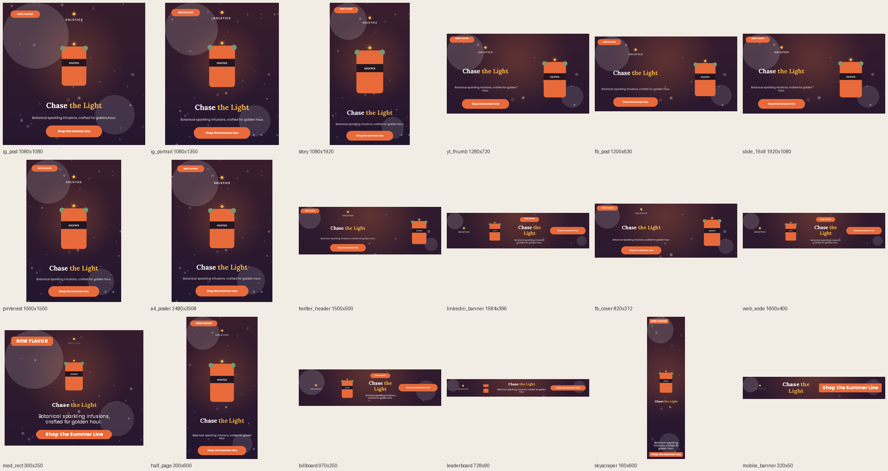
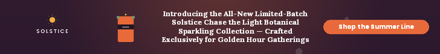

# Chameleon — a design-aware resize engine

**Adobe University Hackathon 2026 · Chameleon Challenge · Stage one submission**

Give the engine a finished design and a new canvas size. It returns the same design **re-laid-out** for that canvas, not stretched or cropped. Element positions, sizes, stacking and type size adapt. Brand colours, fonts, copy, logo, product art and visual hierarchy stay the same.


*One square source design (Level 2) adapted to 18 real-world formats, from Instagram posts and stories to a 728×90 leaderboard.*

---

## Quick start (about 2 minutes)

You need **Python 3.10+** and **git**. There is no GPU, no ML model and no network access at run time.

```bash
git clone <this repo> && cd AdobeHackathon
./setup.sh                    # creates .venv and installs requirements.txt
source .venv/bin/activate
python -m engine.main         # resizes every task in input/
```

For every `input/<task>.json`, this writes `output/<task>_output.json` (the resized design) and `output/<task>_output.png` (a real render through cr-renderer, using the brand fonts and assets).

> **Linux note:** cr-renderer uses skia, which needs `libegl1` and `libgl1`
> (`sudo apt-get install libegl1 libgl1`). The Docker image already includes them.

### Run in Docker (how stage one is scored)

```bash
docker build --platform linux/amd64 -t chameleon-engine .
docker run --rm --network none \
  -v "$(pwd)/input:/app/input" -v "$(pwd)/output:/app/output" \
  chameleon-engine
```

### Try your own design or size

Drop any task JSON into `input/`, using the same shape as the samples: `{"source": {...}, "target_canvas": {"width": W, "height": H}}`. Then run `python -m engine.main` again.

---

## Dependencies and models

| | |
|---|---|
| **ML models** | **None.** The engine is a deterministic layout solver, so there are no weights, no LoRA, no downloads, and the model-size limit doesn't apply. |
| **Engine runtime** (`engine/resize.py`) | Python standard library only. It optionally uses `skia-python` (installed with cr-renderer) or `Pillow` to measure text with the brand fonts, and falls back to a character-width estimate if neither is available. |
| **Rendering / tooling** | `Pillow`, `cr-renderer` (from `requirements.txt`, unchanged from the starter kit). |
| **Network** | Not used at run time. Everything installs at build time, so it works with `--network none`. |
| **Speed** | About 10–30 ms per design on a laptop CPU (excluding rendering). It is deterministic: the same input always gives the same output. |
| **Files edited** | `engine/resize.py` (the engine) and `tools/stress_test.py` (our test harness). Starter plumbing (`engine/main.py`, `renderer/`, `Dockerfile`) is untouched. |

---

## Design philosophy

A good resize moves the furniture. We followed five principles, in priority order:

1. **Respect the original.** If the new canvas has the same shape as the source (within 6%), the designer's own composition is the best layout available. The engine keeps it and only scales it. That happens only if every text stays readable and the source has no overlaps.
2. **Keep the brand and the hierarchy.** Colours, fonts, copy, logo and product art are never altered. All text scales by one shared factor, so the headline stays the most dominant text, then the subhead, then the fine print.
3. **Keep designed units together.** Button shape + label, badge, rotated ribbon, image + caption, and a card panel with its contents all move and scale as one unit. Rows of badges or gallery images stay rows (they wrap only if they must).
4. **Readability comes first.** No body text below 10px (12px for the headline), no text over images, and no cramped word columns. Text is measured with the actual brand fonts, so what the engine plans is what the renderer draws.
5. **Degrade gracefully.** When a canvas is genuinely too small (17 elements into a 728×90 banner), the least important units are hidden in this order: legal → badges / ribbon → secondary text. The headline and CTA are never hidden. Content is never squeezed into illegibility.

---

## How it works

All of this lives in `engine/resize.py`.

```
source design ──► 1. Analyse ──► 2. Lay out (several candidates) ──► 3. Score & choose ──► 4. Finish ──► resized design
```

### 1. Analyse: what is each element?

The input has no semantic labels, so roles are inferred from geometry, z-order, grouping and type size.

| Role | How it's recognised | How it's adapted |
|---|---|---|
| Background | image/shape covering more than 85% of the canvas | full-bleed on the new canvas (`fit: cover`, which is allowed to crop) |
| Decoration | faint (alpha < 0.5) or off-canvas free shapes | scaled, pinned to the same corner, kept fully inside the canvas |
| Logo | small image near the top, wide aspect, or `logo` in the asset name | aspect-locked; pinned top in stacks, leads banner rows |
| Hero image | largest remaining image | aspect-locked; gets the space that's left, never shrinks below the type scale |
| Headline / body / legal | largest font / mid-size / ≤14px near the bottom | one shared type scale with readability floors |
| Button, badge | `group_id`, or a shape containing exactly one label | scaled as a unit; the label is re-fitted to stay on one line and vertically centred |
| Ribbon | rotated group | pinned to its corner; rotated bounds kept on-canvas |
| Row | similar groups or images side by side | laid out as a row, shrinking slightly rather than wrapping |
| Caption | text hugging an image, centred on it | grouped with its image |
| Panel | solid shape behind several elements | re-wrapped around wherever its contents end up |
| Missing asset | `asset_id` not found in `brand_kit/assets/` | hidden (see below) instead of showing a grey placeholder |

### 2. Lay out: try several compositions

For every target, the engine builds each candidate layout below and binary-searches the **largest type scale that fits**:

- **Faithful scale:** same-shape targets only (principle 1).
- **Vertical stack:** for portrait and square targets. Items appear in the source's reading order. The logo is pinned to the top and legal text to the bottom; everything else is centred, with breathing room.
- **Two columns:** for landscape targets. The hero image goes on one side (the side it leaned toward in the source) and the text stack on the other.
- **Banner row:** for wide targets, laid out as logo | hero | text column | CTA. Corner badges join the text column as kickers.

Corner overlays (badges, ribbons) are placed after the main content. If one collides with it, the content area shrinks and the layout is solved again.

### 3. Score and choose

Each candidate gets a score:

- **+** type size kept, relative to the area-preserving scale
- **+** hero image size kept, relative to the source
- **−** anything hidden, weighted by the item's importance
- **−** cramped text (6 or more lines averaging under 16 characters)
- **±** a prior for the target's aspect ratio

Within each layout, the engine also checks whether hiding one or two *minor* items would read noticeably better. The best-scoring candidate wins.

### 4. Finish

- Backgrounds go full-bleed, decorations are re-anchored, and panels are re-wrapped around their contents.
- Every element is clamped inside the canvas. For rotated elements, both the box and its rotated bounds are clamped.
- **Hidden elements** keep their `id` and an in-canvas, in-proportion box, and get `opacity: 0`. For text, the colour alpha is also set to 0, because cr-renderer ignores `opacity` on text. The `content` itself is never changed.
- If every layout fails (which never happened in testing), a uniform letterbox fallback guarantees a valid, undistorted output.

---

## Results

### Official samples

| Level | Resize | What the engine does | Render |
|---|---|---|---|
| 1 · Warm-up | 1080×1080 → 1080×1350 | Vertical stack: logo pinned top, headline + CTA centred | [png](docs/results/official_level1_warmup.png) |
| 2 · Core | 1080×1080 → 1600×400 | Banner row: logo, bottle, "NEW FLAVOR" kicker + two-colour headline + subhead, CTA. Nothing hidden. | [png](docs/results/official_level2_core.png) |
| 3 · Advanced | 1080×1350 → 728×90 | Banner row: logo, bottle, 4-line headline, CTA. Subhead, badges, ribbon and legal are hidden because they can't be legible at 90px. The missing watermark asset is hidden too. | [png](docs/results/official_level3_advanced.png) |



### Stress test: 3 designs × 18 real-world formats

We built and tuned in tiers, starting with the fundamentals:

| Tier | Formats | Pass | Warn | Hard fail |
|---|---|---|---|---|
| 1 · Common social | Instagram post / portrait / story, YouTube thumbnail, Facebook post, 16:9 slide | 18 | 0 | 0 |
| 2 · Web & print | Pinterest, A4 poster, Twitter/X header, LinkedIn banner, FB cover, 1600×400, 300×250, 300×600 | 24 | 0 | 0 |
| 3 · Extreme ratios | 970×250 billboard, 728×90 leaderboard, 160×600 skyscraper, 320×50 mobile banner | 11 | 1 | 0 |

The one warning is Level 3 at 320×50. Fitting a 150-character headline into a 50px-tall banner needs 7px type, so the engine says so honestly instead of overlapping text.

Contact sheets of every render: [Level 1](docs/results/level1_all_sizes.png) · [Level 2](docs/results/level2_all_sizes.png) · [Level 3](docs/results/level3_all_sizes.png)

We also fuzz-tested the engine on designs it was never tuned on, including left-aligned layouts, card panels, captioned image galleries, text-only designs, a lone image, and random designs with rotated or grouped elements and missing assets. All 18 sizes ran with no crashes and no hard-rule failures.

### Reproduce the tests

```bash
python -m tools.stress_test                          # all samples x 18 formats -> output/stress/
python -m tools.stress_test --sizes story,1200x300   # chosen catalogue keys or WxH
python -m tools.stress_test --no-render              # rule checks only (fast)
```

For each pair, the stress test does the following:
- **Checks hard rules:** same ids, unchanged `content` / `font_family` / `asset_id`, nothing off-canvas (including rotated bounds), and images within 5% of their aspect ratio.
- **Flags quality issues:** text colliding with other content, fonts under 9px, and hidden elements.
- **Writes a contact sheet** per design: `output/stress/_sheet_*.png`.

It exits with code 1 if any hard rule fails.

---

## Rules compliance checklist

- [x] Every source element `id` appears exactly once; nothing is added or removed
- [x] No pixels are generated or edited; assets are only repositioned and resized
- [x] Non-background images keep their aspect ratio (only full-bleed `cover` backgrounds crop)
- [x] `content` and `font_family` are unchanged; only `font_size` adapts
- [x] Nothing is off-canvas, including the rotated bounds of rotated elements
- [x] The missing asset (`holiday_watermark`) is handled gracefully, with no crash and no placeholder box
- [x] Runs offline (`--network none`) with no model downloads

## Known limitations and next steps

- **Transparent padding in assets.** Element boxes enclose the whole asset file. The provided logo PNG is about 60% transparent space, so logos can look smaller than their box suggests. A next step would be alpha-aware spacing.
- **Extreme ratios with long copy.** At sizes like 320×50, some content must be hidden. A finale add-on could let the user choose what survives, or offer several layout options.
- **Heuristic roles.** Roles are inferred from geometry. Very unusual designs (e.g. several equally large headlines) may be ranked in an unexpected order. A multimodal model could refine roles in a future version.
- **Copy and font adaptation** are deliberately out of scope for stage one, per RULES.md.

## Repository layout

```
engine/resize.py        the engine (all of our logic)
engine/main.py          starter orchestrator: input/ -> resize() -> output/ (unchanged)
tools/stress_test.py    multi-format test harness + contact sheets
docs/results/           committed renders of the results above
renderer/               vendored converter around cr-renderer (unchanged)
brand_kit/              brand fonts and assets
input/  output/         task files in, results out
RULES.md  FAQ.md  STARTER_README.md  chameleon_design_schema_v0.9.json   challenge docs
```
